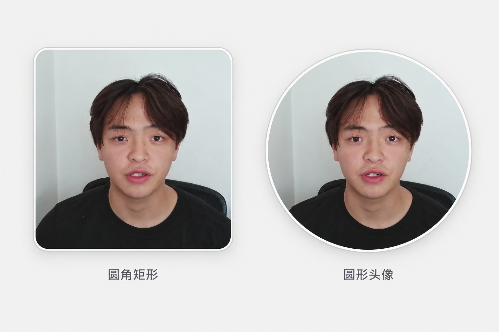

# 已确认的人物窗外观

用户在当前会话查看样稿后回复“没太大问题，可以的。”，确认圆角矩形与圆形头像的外观。此确认只适用于人物窗外观，不等于新视频参数、整体风格、分镜或实际裁切已获批。

- 矩形：柔和圆角，细白边，低对比灰色外沿，柔和向下投影。
- 圆形：完整圆周，细白色描边及浅灰外沿，柔和投影；不允许顶部平切或缺口。
- 边框服务于人物与内容分离，不能厚重、发光或抢占主要内容。
- 样稿是AI生成的外观示意，只可用于核对边框和阴影，不得作为人物视频素材、身份标准或已完成的裁切证据。

## 原生实现起点

以下数值为根据样稿拟定的实现起点，不是用户逐项确认过的精确参数。以窗口短边D为基准：矩形圆角约0.07D，白边约0.006D，外沿约0.002D；投影向下偏移约0.025D、模糊约0.06D、黑色透明度约0.12。圆窗border-radius为50%，其余按实际尺寸适当减轻。手机尺寸仍需检查。

外层负责描边和阴影，内层负责overflow裁切/蒙版；不能把阴影一起裁没。原视频依据完整头部边界映射进内层，不能用object-fit:center替代人物定位。动画中保持圆角、描边和画面同步缩放，保护头发和下巴。源片补边破坏圆周内部观感时改裁切或布局，不用描边掩盖问题。

采用前读取 [人物裁切核查](presenter-crop-validation.md)。以真实视频渲染结果验证，而非复用此生成照片。
